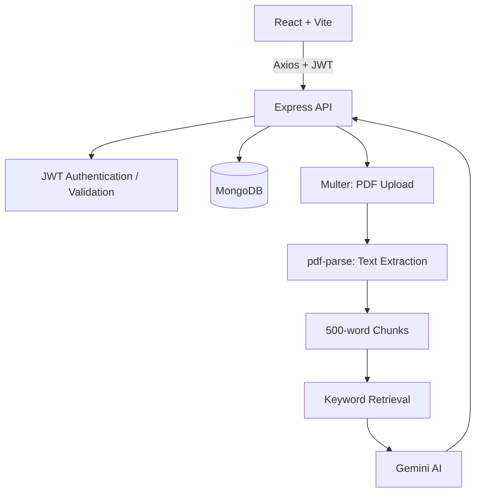

<div align="center">


[](https://react.dev/)
[](https://vite.dev/)
[](https://tailwindcss.com/)
[](https://nodejs.org/)
[](https://expressjs.com/)
[](https://www.mongodb.com/)

**Study smarter. Learn better.**

</div>

---

## ✨ Overview

StudySync is an AI-powered study assistance and learning platform that turns PDF materials into interactive learning resources. Upload and read PDFs, ask document-based questions, generate summaries and concept explanations, create flashcards and quizzes with Google Gemini, and monitor your learning progress.

## 🚀 Features

| Feature | What you can do |
|---|---|
| 🔐 **Authentication** | Register, log in, update your profile, and change your password using JWT and bcrypt. |
| 📚 **PDF library & viewer** | Upload PDFs, extract their text, and read documents alongside study tools. |
| 💬 **AI chat** | Ask questions using document context, with chat history saved per document. |
| 🧠 **Summaries & explanations** | Generate concise document summaries and explanations of difficult concepts. |
| 🃏 **Flashcards** | Generate Easy, Medium, and Hard decks. Flip cards, track reviews, and star cards for later. |
| ✅ **Quizzes** | Generate multiple-choice quizzes with four options, submit answers, view scores, and review explanations. |
| 📊 **Analytics** | Track documents, flashcards reviewed, starred cards, completed quizzes, average quiz score, and recent activity. |

## 🧰 Tech Stack

| Frontend | Backend |
|---|---|
| React 19 + Vite 8 | Node.js + Express 5 (ES modules) |
| Tailwind CSS v4 | MongoDB + Mongoose 9 |
| React Router v7 | Google Gen AI SDK `@google/genai` v2.10.0 |
| Context API + LocalStorage | Gemini `gemini-2.5-flash-lite` |
| Axios, Lucide React | JWT, bcryptjs, Multer, pdf-parse |
| React Markdown, Remark GFM, Syntax Highlighter, React Hot Toast | express-validator |

## ⚙️ How It Works

1. **Upload:** Multer handles the PDF upload and `pdf-parse` extracts its text.
2. **Chunk:** Extracted text is divided into chunks of approximately **500 words**, with a **50-word overlap**.
3. **Retrieve:** Keyword-based retrieval finds relevant chunks when a user asks a question.
4. **Generate:** Relevant context is sent to Gemini to generate answers, summaries, explanations, flashcards, or quizzes.
5. **Store:** Documents and learning activity are stored in MongoDB.

> [!NOTE]
> StudySync uses keyword-based retrieval, not vector embeddings. AI-generated content should be checked against the original document.

## 📁 Project Structure

The following is a suggested structure; adapt it to the actual repository if names differ.

```text
StudySync/
├── client/
│   ├── src/
│   │   ├── components/
│   │   ├── context/         # AuthContext
│   │   ├── pages/
│   │   ├── services/        # Axios API client
│   │   ├── hooks/
│   │   ├── utils/
│   │   ├── App.jsx
│   │   └── main.jsx
│   ├── .env.example
│   └── package.json
├── server/
│   ├── src/
│   │   ├── config/
│   │   ├── controllers/
│   │   ├── middleware/
│   │   ├── models/
│   │   ├── routes/
│   │   ├── services/        # AI, PDF, and retrieval logic
│   │   ├── validators/
│   │   └── server.js
│   ├── uploads/             # Local PDF storage
│   ├── .env.example
│   └── package.json
├── .gitignore
└── README.md
```

## 🛠️ Getting Started

### Prerequisites

- Node.js and npm
- MongoDB (local or hosted)
- Google Gemini API key

### 1. Clone the repository

```bash
git clone https://github.com/<your-username>/StudySync.git
cd StudySync
```

### 2. Install dependencies

```bash
cd server && npm install
cd ../client && npm install
```

### 3. Configure environment variables

Create `.env` files in both `server/` and `client/`.

**`server/.env`**

```env
PORT=5000
MONGODB_URI=mongodb://127.0.0.1:27017/studysync
JWT_SECRET=replace_with_a_strong_secret
GEMINI_API_KEY=your_gemini_api_key
GEMINI_MODEL=gemini-2.5-flash-lite
UPLOAD_DIR=uploads
MAX_FILE_SIZE_MB=10
CLIENT_URL=http://localhost:5173
```

**`client/.env`**

```env
VITE_API_BASE_URL=http://localhost:5000/api
```

> [!IMPORTANT]
> These variable names are examples. Match them to the names used in your configuration files. Never expose `JWT_SECRET`, `GEMINI_API_KEY`, or database credentials in frontend environment variables.

### 4. Run locally

Start the backend and frontend in separate terminals. Use the scripts defined in each `package.json` if they differ from these examples.

```bash
# Terminal 1 — Backend
cd server
npm run dev
```

```bash
# Terminal 2 — Frontend
cd client
npm run dev
```

Open the local URL shown by Vite in your browser.

## 🏗️ Architecture



## 🔒 Production Notes

- Configure production environment variables through your hosting provider.
- Set CORS to allow only your frontend domain and serve the application over HTTPS.
- Keep Gemini and JWT secrets on the backend; never commit `.env` files.
- Enforce PDF type and size limits on the server and check document ownership on every protected request.
- Local uploads may be lost on hosts with ephemeral filesystems. Use persistent storage or object storage for production deployments.
- Validate AI-generated quiz and flashcard data before saving or displaying it.

## 🤝 Contributing

1. Fork the repository.
2. Create a branch for your change.
3. Implement and test your changes.
4. Open a pull request with a clear description.

## 📄 License

Add the license selected by the project owner before publishing. No license was specified in the project details.

---

<div align="center">

### 🌟 StudySync — Study smarter. Learn better.

<sub>Made for focused learning, one document at a time.</sub>

</div>
