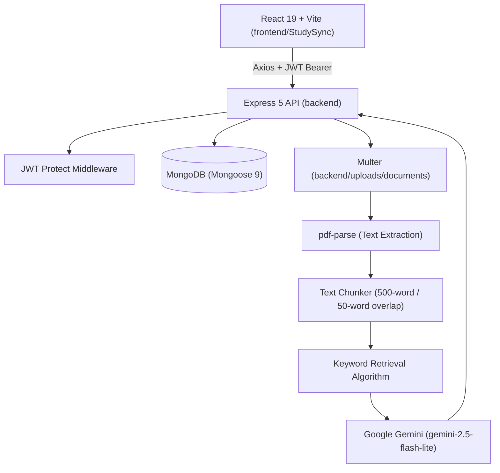

<div align="center">


[](https://react.dev/)
[](https://vite.dev/)
[](https://tailwindcss.com/)
[](https://nodejs.org/)
[](https://expressjs.com/)
[](https://www.mongodb.com/)

**Study smarter. Learn better.**

</div>

---

## ✨ Overview

StudySync is an AI-powered study assistance and learning platform that turns PDF materials into interactive learning resources. Upload and read PDFs, ask document-based questions, generate summaries and concept explanations, create flashcards and quizzes with Google Gemini, and monitor your learning progress in real time.

---

## 🚀 Features

| Feature | What you can do |
|---|---|
| 🔐 **Authentication** | Register, log in, update your profile, and change your password using JWT and bcrypt. |
| 📚 **PDF Library & Viewer** | Upload PDFs, extract their text, and read documents side-by-side with interactive study tools. |
| 💬 **AI Document Chat** | Ask questions using document context retrieval, with persistent chat history saved per document. |
| 🧠 **Summaries & Explanations** | Generate concise document summaries and detailed explanations of difficult concepts on demand. |
| 🃏 **Smart Flashcards** | Generate Easy, Medium, and Hard card decks. Flip cards in 3D, track reviews, and star cards for targeted revision. |
| ✅ **Interactive Quizzes** | Generate 4-option multiple-choice quizzes, submit answers, get auto-graded, and review answer explanations. |
| 📊 **Progress Analytics** | Track total documents, reviewed flashcards, starred cards, completed quizzes, average quiz score, and recent activity. |

---

## 🧰 Tech Stack

| Layer | Technologies |
|---|---|
| **Frontend** | React 19, Vite 8, Tailwind CSS v4, React Router v7, Context API, Axios, Lucide React, React Markdown |
| **Backend** | Node.js (ES Modules), Express 5, MongoDB, Mongoose 9, Multer, pdf-parse, bcryptjs, jsonwebtoken |
| **AI Engine** | Google Gen AI SDK (`@google/genai`) powered by **`gemini-2.5-flash-lite`** |

---

## ⚙️ How It Works

1. **Upload:** Multer handles PDF uploads to `backend/uploads/documents` and `pdf-parse` extracts text.
2. **Chunk:** Extracted text is divided into chunks of ~500 words with a 50-word overlap to preserve context.
3. **Retrieve:** Keyword-based relevance scoring retrieves the most relevant chunks for user queries.
4. **Generate:** Chunks and prompt instructions are sent to Google Gemini (`gemini-2.5-flash-lite`) to generate answers, summaries, flashcards, or quizzes.
5. **Persist:** All user data, documents, chunks, flashcards, quizzes, and chat histories are stored in MongoDB.

---

## 📁 Project Structure

```text
StudySync/
├── backend/
│   ├── config/              # Database and Multer configuration
│   ├── controllers/         # Request handlers (AI, Auth, Documents, Flashcards, Quizzes, Progress)
│   ├── middleware/          # JWT auth and error handling
│   ├── models/              # Mongoose schemas (User, Document, Flashcard, Quiz, ChatHistory)
│   ├── routes/              # Express API route declarations
│   ├── uploads/             # Server storage for uploaded PDFs
│   ├── utils/               # Gemini AI service, PDF parser, and text chunker
│   ├── .env                 # Environment variables
│   ├── package.json
│   └── server.js            # Express server entry point
│
├── frontend/
│   └── StudySync/           # React + Vite application
│       ├── src/
│       │   ├── components/  # Modular UI components (AI, Chat, Flashcards, Quizzes, etc.)
│       │   ├── context/     # AuthContext
│       │   ├── pages/       # Application views (Dashboard, Documents, Quizzes, Flashcards, Profile)
│       │   ├── services/    # Axios API callers
│       │   ├── utils/       # API paths and Axios instance
│       │   ├── App.jsx      # Routes and route protection
│       │   └── main.jsx
│       ├── package.json
│       └── vite.config.js
│
└── README.md
```

---

## 🛠️ Getting Started

### Prerequisites

- **Node.js** (v18+) & **npm**
- **MongoDB** running locally (`mongodb://127.0.0.1:27017`) or MongoDB Atlas
- **Google Gemini API Key** (from [Google AI Studio](https://aistudio.google.com/))

---

### 1. Clone the repository

```bash
git clone https://github.com/<your-username>/StudySync.git
cd StudySync
```

---

### 2. Install dependencies

```bash
# Backend
cd backend
npm install

# Frontend
cd ../frontend/StudySync
npm install
```

---

### 3. Configure environment variables

Create a `.env` file in the `backend/` directory:

**`backend/.env`**

```env
PORT=8000
MONGODB_URI=mongodb://127.0.0.1:27017/studysync
JWT_SECRET=your_jwt_secret_key_here
JWT_EXPIRE=7d
NODE_ENV=development
MAX_FILE_SIZE=10485760
GEMINI_API_KEY=your_gemini_api_key_here
```

---

### 4. Run the application

Start the backend and frontend in separate terminals:

```bash
# Terminal 1 — Backend (http://localhost:8000)
cd backend
npm run dev
```

```bash
# Terminal 2 — Frontend (http://localhost:5173)
cd frontend/StudySync
npm run dev
```

Open **`http://localhost:5173`** in your browser.

---

## 🏗️ Architecture



---

## 📄 License

This project is licensed under the [ISC License](LICENSE).

---

<div align="center">

### 🌟 StudySync — Study smarter. Learn better.

<sub>Made for focused learning, one document at a time.</sub>

</div>
